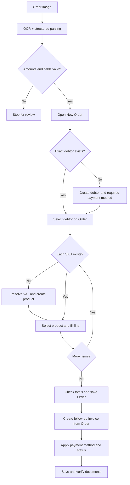

<div align="center">

# Fakturama Automation

### From a purchase-order image to a verified order and linked invoice — through the desktop UI.

**Python · macOS Accessibility API · Tesseract OCR · Apple Vision · OpenCV**

[Quick start](#quick-start) · [How it works](#how-it-works) · [Architecture](#architecture) · [Verification](#verification-and-safety) · [Limitations](#current-limitations)

</div>

---

## Overview

Fakturama Automation is a desktop automation prototype developed for an order-processing take-home assessment. Given an image of a sales order, it extracts and validates the order data, works through Fakturama's user interface, resolves missing master records, and creates an **Order followed by its linked Invoice**.

The implementation targets **Fakturama 2.2.0 on macOS** and uses a combination of accessibility metadata, OCR, and visual anchors to work with controls that are not always exposed to automation tools.

The included demonstration uses `samples/order_northstar.png`. 

## Workflow at a glance



**The central design decision:** open the Order first, check for existing debtors and products *from its selectors*, and return to the same Order after creating any missing records. The invoice is generated using the **saved Order's follow-up action**, preserving the document relationship rather than creating a disconnected invoice.

## What the implementation covers

| Stage | Behavior |
| --- | --- |
| **Document extraction** | Reads the reference, dates, customer, contacts, billing/delivery addresses, payment details, items, discounts, VAT and totals. |
| **Preflight validation** | Checks parsed values and line-item/aggregate arithmetic before beginning UI entry. |
| **Order creation** | Opens a new Order, retains Fakturama's generated number, and fills date, customer reference and Net price mode. |
| **Debtor resolution** | Searches for an existing debtor; creates its master record and addresses when needed. |
| **Payment method** | Reuses an existing method or creates the required term for the debtor workflow. |
| **VAT and products** | Resolves or creates the VAT rate and each missing SKU, then adds lines to the open Order. |
| **Order verification** | Validates the populated lines and totals, saves, and checks the document listing. |
| **Linked invoicing** | Creates the invoice through the Order's follow-up action and applies payment details. |
| **Final verification** | Checks the saved Order/Invoice and the persisted payment state. |

This workflow is deliberately conservative about ambiguous UI matches: an uncertain match should lead to a manual-review stop rather than a guessed click or duplicate record.

## Quick start

### Prerequisites

- **macOS** with **Fakturama 2.2.0** installed and configured with a workspace.
- **Python 3.12** and [Homebrew](https://brew.sh/) for the example installation below.
- **Tesseract OCR** (`brew install tesseract`).
- macOS **Accessibility** and **Screen Recording** permission for the Terminal or IDE used to launch Python.
- An active desktop session with Fakturama open. Keep the Fakturama window visible and avoid interacting with it during the run.

> This implementation uses Apple's Accessibility (AX) API; **Microsoft UI Automation is not available on macOS**. The code has not been validated on Windows or Linux.

### 1. Install

```bash
git clone https://github.com/allaa-undecided/fakturama-workflow.git
cd fakturama-workflow

brew install tesseract
python3.12 -m venv .venv
source .venv/bin/activate
python -m pip install -r requirements.txt
```

If `python3.12` is not installed, install it with Homebrew first (`brew install python@3.12`) or use a compatible Python installation.

### 2. Grant macOS permissions

In **System Settings → Privacy & Security**, enable:

- **Accessibility** for your Terminal/IDE (reading and interacting with controls).
- **Screen & System Audio Recording** / **Screen Recording** for your Terminal/IDE (capturing screen content for OCR and screenshots; wording varies by macOS version).

Restart the terminal application if macOS requires it after granting access.

### 3. Inspect the current UI state

Open Fakturama and the workspace you intend to use, then run:

```bash
python run.py --probe
```

This reports detected windows and tabs, reads visible UI text, and writes a diagnostic screenshot. Use it to confirm that the correct app and workspace are accessible before changing records.

### 4. Run against the sample

```bash
python run.py samples/order_northstar.png
```

## How it works

### 1. Extract and validate the order

`fakturama_auto/extract.py` uses **Tesseract word-level bounding boxes** to interpret the supplied order format. It identifies sections and column labels, associates values by position, and constructs typed order data. **Apple Vision** provides a second OCR check on key dates, reference fields and totals.

Amounts are handled with Python's `Decimal`, reducing avoidable floating-point errors in financial comparisons. Extraction or arithmetic inconsistencies stop the workflow before the initial UI interaction.

### 2. Ground UI actions in observed controls

Fakturama's SWT interface does not expose every grid cell or widget through a consistent accessibility tree. The automation therefore combines three techniques:

1. **Accessibility-first:** locate controls by role/title, interact with accessible fields, and read values back.
2. **OCR anchors:** recognize visible labels when accessibility metadata is incomplete and interact relative to their positions.
3. **Visual analysis:** use screenshot/image processing for controls or selected table rows that are not otherwise discoverable.

This approach avoids making fixed absolute screen coordinates the primary interface contract. It is nevertheless sensitive to changes in UI rendering, focus, screen geometry, language and Fakturama versions.

### 3. Preserve the Order-first relationship

The workflow checks existing records from within the current Order. When a debtor, payment term, VAT or product is missing, the corresponding creation flow runs and the automation returns to the Order. After saving the Order, the linked Invoice is generated from its **Create a follow-up document → Invoice** action, rather than the global New Invoice button.

### 4. Verify before proceeding

The implementation checks intermediate values and document state as it proceeds. It uses read-back for writes where available, checks item arithmetic against the source, saves each final document through its UI control, and searches the Documents view for evidence of the saved records. Details of the sample run, observed exceptions and UI-specific behaviors are documented in [`PRD.md`](PRD.md).

## Example: the included Northstar order

The sample purchase-order image contains a two-line, paid order for **Northstar Office GmbH**.

| SKU | Description | Qty | Unit net | Discount | Line net |
| --- | --- | ---: | ---: | ---: | ---: |
| `CHR-ERG-01` | Ergonomic Desk Chair | 2 | 250.00 | 10% | 450.00 |
| `MAT-DESK-02` | Anti-Fatigue Desk Mat | 3 | 40.00 | 0% | 120.00 |

| Amount | Value |
| --- | ---: |
| Net | **570.00** |
| VAT (19%) | **108.30** |
| Gross | **678.30** |

- **External reference:** `WEB-2026-0714-A17`
- **Order date:** 2026-07-14
- **Payment method:** Bank Transfer
- **Status:** Paid on 2026-07-18
- **Source currency:** EUR

The documented test run in [`PRD.md`](PRD.md) records an Order (`PO000004`) and a linked paid Invoice (`INV000003`), with the expected gross total. These are **historical identifiers from that test workspace**, not numbers the script expects or assigns on future runs.

**Currency caveat:** the sample image uses **EUR**, but the configured Fakturama workspace displayed **$**. The prototype compares the numerical amounts and does **not** enforce workspace currency consistency. A production implementation should verify the currency explicitly before posting.

## Architecture

```text
fakturama-workflow/
├── run.py                    # Command-line entry point and --probe
├── main.py                   # Additional repository entry point
├── fakturama_auto/
│   ├── extract.py            # OCR, document parsing, validation
│   ├── models.py             # Structured source entities and amounts
│   ├── flow.py               # Ordered, resumable workflow
│   ├── ax.py                 # macOS Accessibility helpers
│   ├── screen.py             # Screen OCR, visual grounding, captures
│   ├── ui.py                 # Common UI actions and controls
│   ├── errors.py             # Manual-review exception
│   └── steps/                # Debtor, payment, VAT/product, order, invoice
├── samples/
│   └── order_northstar.png   # Assessment input image
├── tests/                    # Automated checks
├── docs/                     # Supporting documentation and captures
├── PRD.md                    # Requirements, sample run, findings and gaps
└── requirements.txt
```

The separation is intentional: **extraction** deals with source data, **UI adapters** deal with how controls are found and operated, and **steps/flow** deals with business-process order and verification.

## Verification and safety

Financial UI automation should **fail visibly**, not silently post plausible-looking but incorrect data. The prototype incorporates several safeguards:

- **Before UI activity:** validate the order structure, item arithmetic and summary totals.
- **Before master-data creation:** search for existing records to reduce duplication.
- **During data entry:** use accessibility read-back and screen-based checks where supported.
- **Before saving:** compare the populated Order against the extracted source.
- **After saving:** inspect saved document rows and verify the invoice's paid information.
- **On uncertainty:** stop for manual review rather than making an unsupported selection.

These checks reduce risk; they do not make the process atomic or guarantee that partial writes cannot occur. An interrupted run may require reviewing the workspace before retrying. The UI may also truncate identifiers in listings, limiting the strength of verification from visible text alone.

## Current limitations

This was scoped as a **time-boxed implementation**, so the boundaries matter:

| Area | Current boundary |
| --- | --- |
| **Document variety** | The extractor is tailored to the layout of the supplied assessment image; arbitrary invoices, scans or suppliers are not supported generically. |
| **Platform/version** | Implemented for Fakturama 2.2.0 on macOS, not validated across operating systems or versions. |
| **UI stability** | OCR anchors and visual matching can fail when controls change, text is clipped, focus moves or display geometry differs. |
| **Currency** | Numeric totals are verified, but the EUR-to-`$` workspace mismatch is not resolved. |
| **Input validation** | Fakturama rejects the sample `.test` email domain; the documented saved record did not retain that email. |
| **Repeat execution** | Re-running may create additional Orders/Invoices; there is no fully transactional idempotency layer. |
| **Resuming** | Checkpoint runs require the expected existing UI state and must be used carefully. |
| **Scope** | The workflow stops at verification of the linked Invoice; it does not create delivery, correction or dunning documents. |

### What I would improve next

1. **Reliable idempotency and recovery.** Persist checkpoints with record identities; check existing orders by an exact reference plus customer before any new write; support safe restart after partial completion.
2. **Stronger record matching.** Compare full debtor/address attributes and exact SKUs using a more structured table reader rather than relying on truncated visible rows.
3. **Currency and data-contract enforcement.** Reject unsupported currency/workspace mismatches and invalid required fields before posting.
4. **Broader test coverage.** Add mocked UI-state transition tests, extraction fixtures covering poor scans and alternate layouts, and repeat-run regression tests.
5. **Better observability.** Produce a machine-readable run report with screenshots, step timings, decisions, validation results and saved record identifiers.

## Documentation and evidence

- [`PRD.md`](PRD.md) — source fields, the documented completed run, step-level status, observed UI behavior and outstanding issues.
- [`docs/`](docs/) — supporting artifacts; any screenshot evidence included in the repository can be inspected here.
- [`samples/order_northstar.png`](samples/order_northstar.png) — supplied image used for the demonstration.
- [`tests/`](tests/) — local automated checks; run with `python -m pytest tests`.

---

<div align="center">

**Built as a practical exercise in document understanding, stateful desktop automation, and verification-first workflow design.**

</div>
